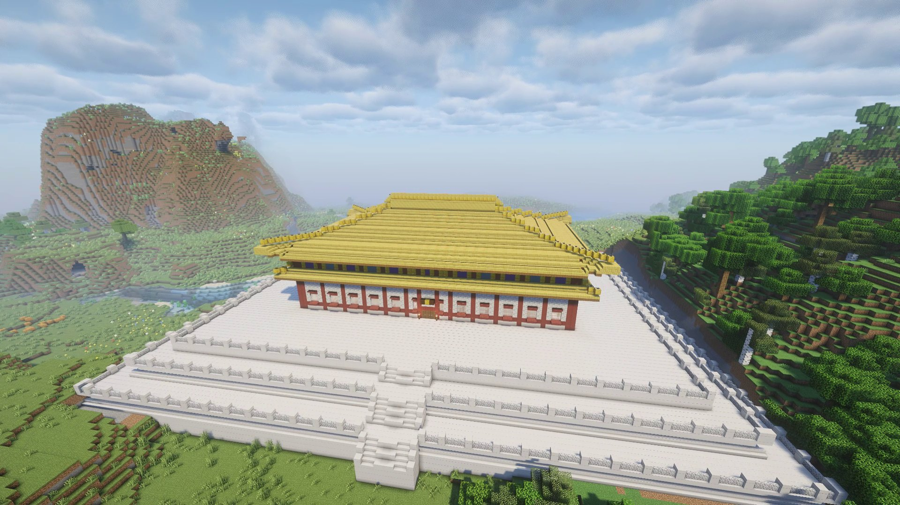
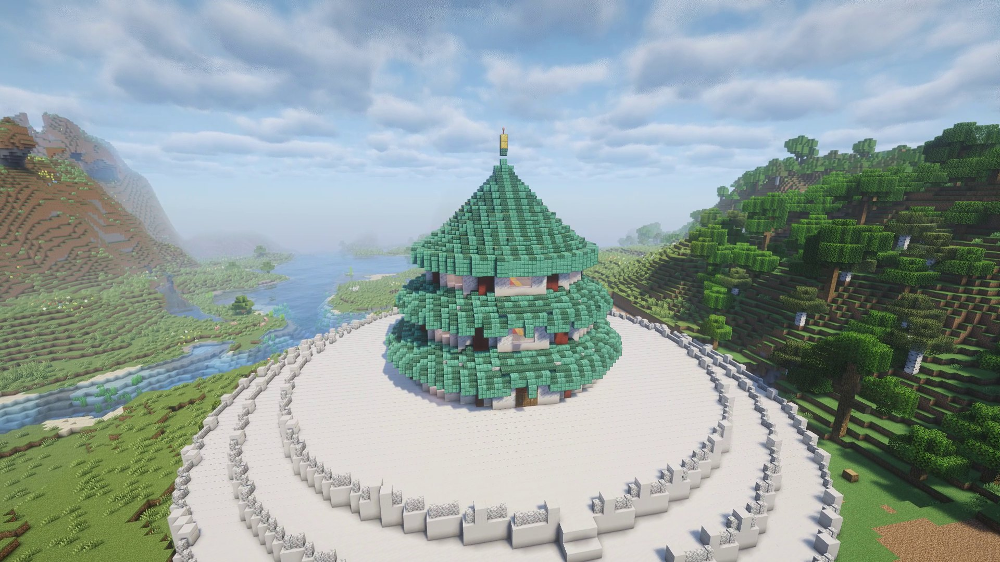
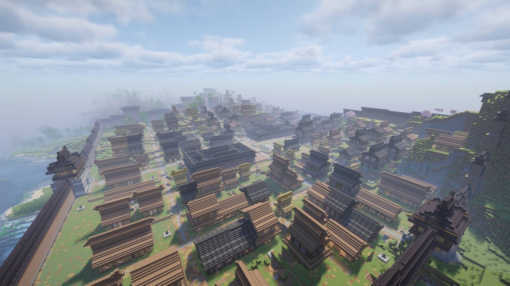
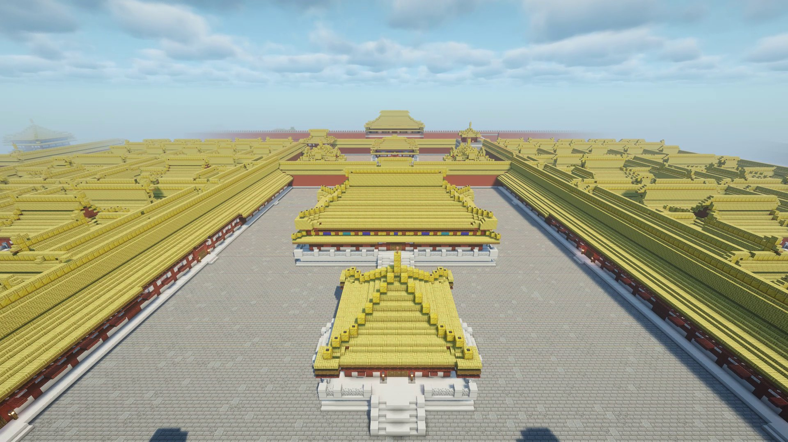
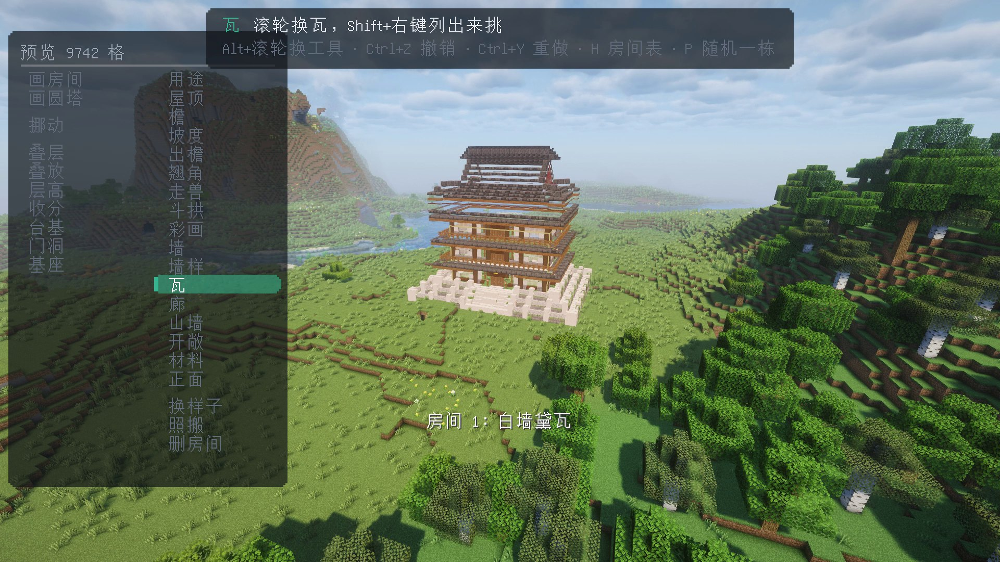
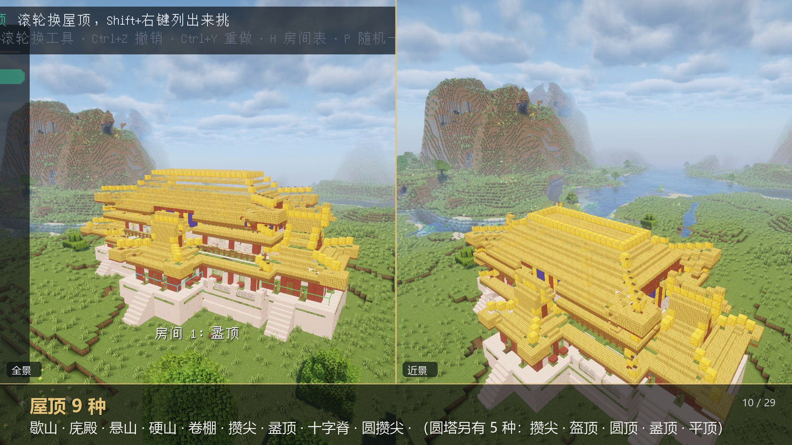

# 营造 · Flying Eaves

**一键生成中式古建筑：从单体的大殿、楼阁，到院落，乃至整座城镇；1:1 紫禁城。**

*One-click Chinese traditional architecture for Minecraft — from a single hall or tower to a courtyard, a whole town,
and the Forbidden City at 1:1.*

Minecraft **Forge 1.20.1** 模组 · 纯 Java，不需要 Python · MIT 许可证 · [English below](#english)



| | |
|---|---|
|  |  |
| **祈年殿**：圆塔 + 三重檐 + 三层圆坛 | **随机城镇**：照着真实地形排街道、院落、城墙 |
|  |  |
| **紫禁城 1:1**：约 780×1070 格、575 个房间 | **单体建造**：左边工具栏，滚轮改参数，半透明实时预览 |



---

## 功能

### 单体建造（H）

在地上右键两个对角画一间房（或一座圆塔）；可以画好几间，相连、叠层都行。每改一样东西，准星前就出一份**半透明的实时预览**
（只画不写，不动世界），满意了再「生成」。所有操作都能 **Ctrl+Z 撤销 / Ctrl+Y 重做**。

左边的工具栏一共 37 个工具，其中 32 个用**滚轮**调（右键、左键等于滚一格；Alt+滚轮换工具）——房间表里的每一项都有一个滚轮工具。
对准星指着的那间用不上的工具在工具栏里变暗（比如平座只给两层以上的圆塔、门洞只给城台、台阶坡度要先有台基），滚了也不改，只说为什么：

| 工具 | 滚轮调什么 | 选项 |
|---|---|---|
| 挪动 | 沿视线挪房间；Ctrl 上下挪 | — |
| 形状 | 这间是什么 | 16 种：矩形、圆塔、牌楼、影壁、随墙门、琉璃门、垂花门、宫墙、铺地、河桥、陈设、台地、街道、石阶、石桥、地块 |
| 叠层 | 层数 | 加减 |
| 叠放 | 放在地上 / 叠在下面那间顶上 | 2 |
| 层高 | 每层多高 | 4–16 格；调过的从 4 再往下回到自动 |
| 收分 | 每往上一层四边收几格（塔、楼阁） | 0–3 |
| 平座 | 圆塔每层一圈带栏杆的走廊（两层以上的圆塔） | 2：无、每层一圈 |
| 台基 | 台基高度；Ctrl 换样式 | 高 0–6、8、10、12 格（10 档）；样式 4 种：平台、须弥座、三层、城台 |
| 台基形状 | 台基方圆（要先有台基） | 3 种：跟随、方、圆 |
| 台阶 | 台基、台地前台阶的坡度（要先有台基；城台没有） | 4 档：45°、27°、18°、14° |
| 边距 | 墙脚到台基边几格（要先有台基） | 10 档：自动、1、2、3、4、6、8、12、16、20 |
| 门洞 | 城台的门洞 | 5 种：自动、无、一个、三个、五个 |
| 基座 | 台基和地基的材料 | 9 种：石砖、和墙脚一样、青砖、白石、夯土、土砖、毛石、砂岩、黑石 |
| 屋顶 | 屋顶形式 | 9 种：歇山、庑殿、悬山、硬山、卷棚、攒尖、盝顶、十字脊、圆攒尖（圆塔另有 5 种：攒尖、盔顶、圆顶、盝顶、平顶） |
| 檐 | 单檐 / 重檐 / 三重檐 | 3 |
| 坡度 | 屋顶坡度 | 5 档：自动、缓、中、陡、很陡 |
| 出檐 | 屋檐伸出多远 | 5 档：自动、短、中、长、很长 |
| 翘角 | 四角翘起多少 | 5 档：自动、无、小、中、大 |
| 走兽 | 戗脊上的小兽 | 6 档：自动、无、3、5、7、9 |
| 斗拱 | 檐下斗拱 | 5 档：自动、无、一层、两层、三层 |
| 彩画 | 梁枋彩画 | 4 种：无、旋子、和玺、苏式 |
| 墙 | 墙的做法 | 12 种：红柱白墙（殿）、深色木、白墙黛瓦、青砖、红砖、木骨白墙、原木、石砌、土坯、黄土、白玉、岩石 |
| 墙样 | 窗和墙段样式 | 6 种：随机、小窗、槛窗、隔扇、直棂窗、花窗 |
| 瓦 | 屋瓦 | 10 种：灰瓦、绿琉璃、黄琉璃、黑瓦、红瓦、碧瓦、石板、木板、茅草、泥瓦 |
| 廊 | 檐柱和披檐 | 5 种：无廊、前廊、后廊、前后廊、周围廊 |
| 山墙 | 普通山墙 / 马头墙（徽派） | 2 |
| 用途 | 准星指着的那一层做什么用（右键列出来挑） | 74 种：堂屋、卧房、书房、客栈大堂、茶馆、药铺、祠堂、丹房、藏经、大殿（宝座）……、空房（什么都不摆、不点灯） |
| 内饰 | 整栋屋里摆不摆家具、灯（不用指着房间） | 2：有、无（只有墙、隔断、楼梯、梯子，屋里空着） |
| 开敞 | 墙面开敞；Ctrl 切出入口 | 开敞 4 种：封闭、正面敞开（戏台）、全敞开（亭）、穿堂；出入口 3 种：前、前后、四面 |
| 每层开敞 | 准星指着的那一层的开敞（圆塔没有） | 5 种：同整间、封闭、正面敞开、全敞开、穿堂 |
| 正面 | 正面朝向 | 4 个方向 |
| 换样子 | 指着房间：只换这间；Ctrl：只换屋顶；不指着：整栋换；往回滚回到原来的样子 | 不限 |

不用滚轮的 5 个：**画房间**、**画圆塔**、**材料**（在面前摆出材料板，往格子里放任何方块——包括其他模组的——替换那一部分的材料）、
**照搬**（把一间的样子照搬到另一间）、**删房间**。

**房间表**（再按 H）：每间房一组设置——形状（矩形、圆塔，以及牌楼、影壁、随墙门、琉璃门、垂花门、宫墙、铺地、河桥、陈设、
台地、街道、石阶、石桥、地块，共 16 种）、叠放、层数、层高、收分、平座、台基（高、样式、形状 3 种、台阶坡度 4 种 45°/27°/18°/14°、
边距 10 档、门洞、基座）、屋顶、瓦、檐、坡度、出檐、翘角、走兽、斗拱、墙、墙样、彩画、廊、山墙、出入口、开敞（也可以每层单独设）、
正面、样子、每层的用途，以及整栋的**内饰**（有 / 无）；还有**设为默认样子**、**存下这栋**、**我的存档**和**预设库**。

### 随机预览（K）

在准星处随机出一栋建筑的预览——从 10 种平面里挑（单殿、凸字带抱厦、主殿两厢、前殿穿廊后殿、十字、塔院、城楼、楼阁、阙门、
重楼），每个框随机大小、每项参数随机。再按 K 换一栋；看中了按 H 接着细调，然后生成。

### 预设库

载入以后能接着改的 129 份设计：

- **古建**（10）：太和殿、祈年殿、佛光寺东大殿、应县木塔、黄鹤楼、佛香阁、西安钟楼、小雁塔、承启楼、徽派民居
- **宫城**（2）：**紫禁城 1:1**（约 780×1070 格、575 个房间）、**随机宫城**
- **故宫**（31）：前朝三大殿、太和门、后三宫、午门、神武门、东华门、角楼、文渊阁、体仁阁、戏台、各式亭子、金水桥、影壁、日晷、嘉量……
- **塔**（6）、**亭**（2）、**民居**（6：四合院、徽派、南方）、**日式**（1：天守阁）
- **O 模板**（71）：凡人的住宅、作坊、商铺、公署寺观，院落，修士的殿堂、楼阁、工坊、居所、坊市

### 随机一院 · 随机城镇 · 随机宗门 · 一句话

- **随机一院**：住宅或宫院，1–3 进，每次现排、不重样。
- **随机城镇**：村 / 镇 / 大镇；街道一字、丁字、十字、Y 字、沿河、棋盘；可以自定宽 × 深（比如 300×300）；照着准星周围的
  **真实地形**排，高低之间砌挡土墙、接台阶。
- **随机宗门**：练气到化神 5 个境界，主峰加卫星峰，照着地形排。
- **一句话**：在房间表里打一句话（如「重檐歇山大殿，高 30 格」），认出来的设计放在准星处，可以接着改。

### 建造菜单（O）

选一种建筑（凡人的茅屋到化神的主殿、宗门地点，共 **87 种**）和境界（凡人、练气、筑基、金丹、元婴、化神），放在准星处；
「换一个」「撤销」。

### 撤销

每次放置都能撤销：房间表或建造菜单里点「撤销」，拆掉上一栋放下的建筑，原来的方块原样恢复（1:1 紫禁城的撤销约十几秒）。

### 其他

- 命令（需要 OP）：`/flyingeaves export <名字>` 把上一栋导出成结构 `.nbt`；`/flyingeaves part pos1|pos2|save|savebay|saveornament …`
  把自己搭的家具、墙段、装饰存成生成器的部件。
- 只有中文界面。只能单人游戏（或开局域网的那台主机）用：方块经由内置服务器放置。

## 安装

1. 装好 **Minecraft 1.20.1 + Forge 47.x**（47.4.28 测过），**Java 17**。
2. 从 [Releases](https://github.com/yang-devv/FlyingEaves/releases) 下载 `flyingeaves-1.0.0.jar`（或自己构建，见下），放进游戏目录的 `mods/`。
3. 启动游戏。不用装别的，也不用 Python。

模组在 `<游戏目录>/flyingeaves/` 里放它的工作文件：玩家存的设计 `designs/`、自定材料 `materials/custom.json`、部件 `parts/`、
导出的结构 `exports/`，以及启动时写出的建筑列表和预设库。和存档无关；除了自己存的东西，删了下次启动会重写。

### 内存

单体建筑、院落用启动器默认的内存（`-Xmx2G`）就够；随机宫城、300×300 的城镇 `-Xmx3G` 足够。**1:1 紫禁城需要 `-Xmx4G`**
（启动器里的「JVM 参数」）：约 216 万个方块、写进世界约 3000 万格，生成 30–40 秒，放下 15 秒到一分半。实测 `-Xmx3G`
也能跑完（生成、放下、撤销、存档退出都成功，堆峰值约 3.0 GB），但 4G 更稳。内存不够时不会崩游戏，会提示要多少。

## 按键（默认，可在「控制」里改）

| 键 | 功能 |
|---|---|
| **H** | **单体建造**：右键两个对角画房间；再按 H 打开房间表 |
| **K** | **随机预览**：准星处出一栋随机建筑的预览（再按换一栋） |
| **O** | **建造菜单**：选一种建筑和境界，放在准星处 |

单体建造里：滚轮调当前工具，Alt+滚轮换工具，Ctrl+Z 撤销，Ctrl+Y 重做。

## 两种构建

同一份代码出两种 jar：

| | 命令 | 生成器 | 给谁 |
|---|---|---|---|
| **纯 Java（默认）** | `./gradlew build` | Java 版，在游戏进程里跑 | 玩家（Releases 里的就是这个） |
| **Python 后端** | `./gradlew build -PwithPython=true` | 原版 Python 生成器（`generator/`），由模组启动 | 开发 / 对照参考；需要 **Python ≥ 3.10** |

Java 生成器（`com.flyingeaves.gen`）是 Python 原版（`generator/`，只用标准库）的**逐字节移植**：同一个请求，两边放下的方块一格不差。
Python 版留在仓库里作为参考实现和测试的「神谕」（oracle），见 [`PORTING.md`](PORTING.md) 和 `tools/oracle/`。

`-PwithPython=true` 的 jar 里带着 Python 生成器，配置文件 `config/flyingeaves-client.toml` 多出几项：

- `backend = "java"`（默认）：Java 生成器干活，做不了的（比如超出空闲内存）交给 Python；`backend = "python"`：全部交给 Python
  生成器（游戏启动时启动它）。
- `pythonPath`：Python 解释器（空着就找 `<游戏目录>/flyingeaves/python/`、PATH 上的 `python` / `py -3` / `python3`）。
- `autoStart`：是否自动启动 Python 生成器。

Python 生成器从 jar 解到 `<游戏目录>/flyingeaves/generator/`，以 `bgen_daemon.py` 常驻进程运行，游戏退出时一起退出；和游戏之间用
`<游戏目录>/flyingeaves/requests/`、`out/` 里的文件通信；日志在 `logs/flyingeaves-generator.log`。

## 从源码构建

需要 JDK 17（Gradle 会通过 toolchain 自动找 / 下载）。

```
./gradlew build --max-workers=4      # build/libs/flyingeaves-1.0.0.jar（纯 Java；含测试）
./gradlew build -PwithPython=true    # Python 后端的 jar
./gradlew runClient                  # 开发客户端（run/）
./gradlew runClient -Pdev=true       # 加开发命令管道：往 run/flyingeaves-commands.txt 追加命令，结果在 run/flyingeaves-dev.log
./gradlew runClient -PclientXmx=4G   # 开发客户端多给内存（1:1 紫禁城）
```

## 测试

- `./gradlew test`：JUnit **对照测试**（oracle）——Java 生成器对着从冻结的 Python 生成器录下来的答案（`src/test/resources/oracle/`，
  每个请求放下的方块的哈希、设计 JSON）逐个比对：193 个单体 / 设计用例、125 个建造菜单用例、86 个规划用例（院落、城镇、宗门、
  一句话）、从 jar 读数据的用例、启动文件的用例。不需要 Python，也不需要 Minecraft。`./gradlew build` 会跑它。
- `./gradlew slowTest`：1:1 紫禁城（约 30 秒、1.5 GB 堆）。
- 有 Python 时：`python -I tools/oracle/oracle.py suite 20` 现场跑两边比对；`python -I tools/oracle/capture.py` 重录答案。
  Python 生成器自己的检查在 `generator/`（`selfcheck.py`、`test_*.py`、`towncheck.py`）。

## 许可证

[MIT](LICENSE) © 2026 Yang。少量算法和数据表的来源见 [`THIRD_PARTY_NOTICES.md`](THIRD_PARTY_NOTICES.md)。

## 致谢

「画房间、逐间设定、生成」的思路受 simibubi 的 [The Mighty Architect](https://github.com/simibubi/TheMightyArchitect) 启发，
在此致谢。本项目与 The Mighty Architect 及其作者没有任何关联，也不含它的代码或主题。

---

<a id="english"></a>

## English

**Flying Eaves (营造)** is a Minecraft **Forge 1.20.1** mod that generates Chinese traditional architecture in one
click: single halls, towers and pavilions, courtyards, whole towns laid out on the real terrain, cultivation sects,
a random palace city — and the **Forbidden City at 1:1**. The generator runs inside the game in pure Java; **no
Python needed**. Chinese UI only; single player (or a LAN host) only.

### Features

- **H — single building (单体建造)**: right-click two corners to draw rooms (rectangles or round towers; joined or
  stacked). 32 scroll-wheel tools set every setting of each room, the room table's included: shape (16), storeys,
  storey height, taper, pingzuo balconies, podium (height, 4 styles, 3 shapes, 4 step slopes, 10 margins, gate
  tunnels, 9 base materials), 9 roof forms (+5 for round towers), single/double/triple eaves, pitch, overhang, corner
  lift, ridge beasts, bracket sets, 4 painted-beam styles, 12 wall styles, 6 window/bay styles, 10 roof tiles, 5
  veranda layouts, horse-head gables, openness and entrances (also per floor), 74 room uses per floor (空房: an empty room), facing,
  "reroll", and 内饰 有 / 无 (the whole building without furniture and lamps; walls, partitions, stairs kept); tools that do nothing for the aimed room are dimmed. Plus a material board that accepts any block (other mods' too), copy-style,
  and 16 shapes in all (gates, screen walls, palace walls, bridges, streets, terraces…). A **translucent live
  preview** follows every change; Ctrl+Z / Ctrl+Y undo and redo. Press H again for the **room table**: every setting
  per room, saves, a default style, and the preset library.
- **K — random preview**: a random building at the crosshair (10 plan types, every setting random); K again for
  another, H to fine-tune it.
- **Preset library**: 129 editable designs — historic buildings (太和殿, 祈年殿, 佛光寺东大殿, 应县木塔, 黄鹤楼…),
  31 Forbidden City buildings, pagodas, pavilions, vernacular houses, and the **Forbidden City 1:1** (about 780×1070
  blocks, 575 rooms) plus a random palace city.
- **Random courtyard / town / sect**: courtyard compounds of 1–3 courts; towns (village / town / big town, six street
  plans, any size such as 300×300) laid out on the real terrain with retaining walls and steps; sects of five
  cultivation tiers across a main peak and satellite peaks; and **one-sentence designs** ("a double-eave hip-and-gable
  hall, 30 blocks high").
- **O — build menu**: 87 building kinds × six tiers, placed at the crosshair.
- **Undo** for every placement (the 撤销 button in the room table or the build menu; the original blocks come back
  exactly). `/flyingeaves export <name>` saves the last
  building as a structure `.nbt`.

### Install

Minecraft 1.20.1 with Forge 47.x (tested with 47.4.28) and Java 17. Drop `flyingeaves-1.0.0.jar` (from
[Releases](https://github.com/yang-devv/FlyingEaves/releases), or build it) into `mods/`. Nothing else.
**Memory**: the default `-Xmx2G` is fine for buildings and courtyards, `-Xmx3G` for the palace city and big towns;
**the 1:1 Forbidden City needs `-Xmx4G`** (about 2.16 M blocks; 30–40 s to generate, 15–90 s to place). If memory
runs short the mod says so instead of crashing.

### Keys

**H** single building / room table · **K** random preview · **O** build menu (rebind under Controls). In single
building mode: scroll to change the current tool's setting, Alt+scroll to switch tools.

### Two builds from one codebase

- `./gradlew build` → `build/libs/flyingeaves-1.0.0.jar`: **pure Java** (the release; for players).
- `./gradlew build -PwithPython=true` → the **Python-backed** jar: it carries the original Python generator
  (`generator/`, standard library only, **Python ≥ 3.10**), which the mod starts as a daemon and stops with the game.
  Config `backend = "python"` sends every request to it; `backend = "java"` (default) uses Java with Python as a
  fallback; also `pythonPath`, `autoStart`. For development and as a reference.

The Java generator is a byte-for-byte port of the Python one; the Python generator stays in the repository as the
reference implementation (see [`PORTING.md`](PORTING.md), `tools/oracle/`).

### Build and test

```
./gradlew build --max-workers=4   # jar + JUnit oracle tests
./gradlew slowTest                # the 1:1 Forbidden City case
./gradlew runClient -Pdev=true    # dev client with the command pipe (run/flyingeaves-commands.txt)
```

The JUnit **oracle tests** compare the Java generator with answers captured from the frozen Python generator
(hashes of every block placed, design JSON text): 193 building/design cases, 125 build-menu cases, 86 planner cases,
jar-data and start-up-file cases. They need neither Python nor Minecraft.

### License and credits

[MIT](LICENSE) © 2026 Yang; see [`THIRD_PARTY_NOTICES.md`](THIRD_PARTY_NOTICES.md) for a few reproduced algorithms
and tables. The "draw rooms, set each one, generate" approach was inspired by simibubi's
[The Mighty Architect](https://github.com/simibubi/TheMightyArchitect) — with thanks. This project is not affiliated
with The Mighty Architect or its author and contains none of its code or themes.
